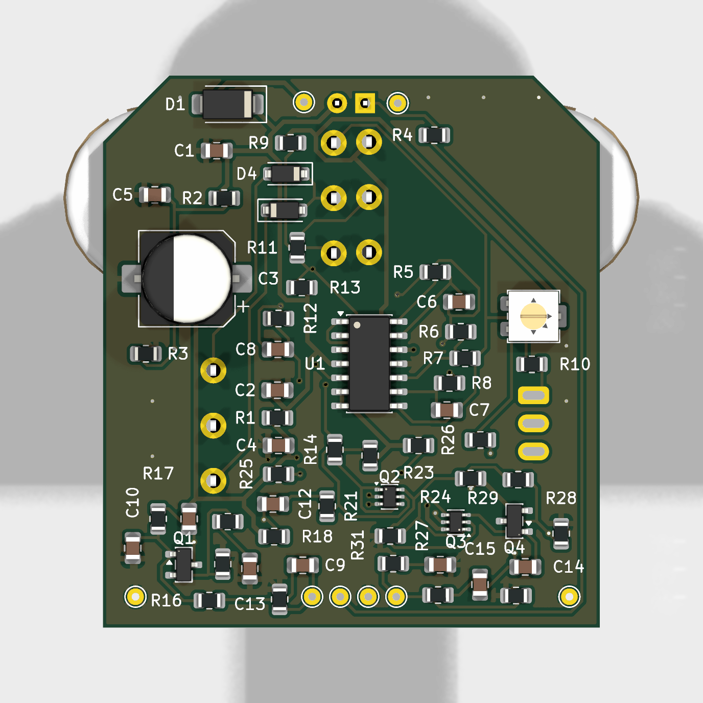

# Trem (SMD)

A tremolo for guitar in a Hammond 1590B: a TL064 LFO with SHAPE and SQ/TRI, driving a **discrete LM3086-style transistor VCA**. SMD parts are assembled by JLCPCB; the pots, toggle and LED are hand-soldered on the back (panel side).



## Controls

| Control | Part | Function |
|---|---|---|
| RATE | RV1 A10k | LFO speed, ~2–17 Hz (measured) |
| SHAPE | RV2 B100k | LFO skew: ramp up ↔ triangle ↔ ramp down |
| DEPTH | RV3 B100k | Tremolo depth, up to full cut |
| SQ/TRI | SW1 | Square or triangle LFO |
| Balance (trim) | RV4 2k (v2.1: symmetric, wiper to VA) | Nulls the LFO "thump" bleed |

Note: on this revision RATE and DEPTH turn backwards (fully CCW = fast / max) because the back-mounted pots mirror lugs 1 and 3. Fix planned for the next revision.

## How it works

- **LFO:** U1D integrator + U1C Schmitt trigger make the triangle and square. RATE sets the drive level; diodes D3/D4 with SHAPE set separate rise and fall rates.
- **Control:** DEPTH → U1A (inverting, offset by R13) sets the VCA tail current through R14.
- **Audio:** Q1 (MMBT5089) preamp → ÷48 → Q2 differential pair (gain ∝ tail current) → Q3 pair + Q4 PNP output amp → OUT.
- A reusable write-up of the VCA: [docs/VCA Building Block.md](docs/VCA%20Building%20Block.md).

Schematic: [Trem_23_schematic.pdf](Trem_23_schematic.pdf) · Layout: [Trem_23_layout.pdf](Trem_23_layout.pdf)

## Build notes

- **Hand-soldered (back side):** RATE/SHAPE/DEPTH 16 mm pots, SW1 (**sub-miniature** SPDT, 2.54 mm pitch, e.g. Taiway 200MSP1T1B1M1QE or Dailywell 2MS1; standard mini toggles do not fit), the LED, and the wire pads.
- Power: 9 V centre-negative; SS14 series reverse-polarity protection; ~3.2 mA (+ LED).
- Set RV4 for minimum LFO bleed at OUT (DEPTH max, no input, scope at 10 mV/div).
- Details: [docs/Build Notes.md](docs/Build%20Notes.md).

## Status

- Boards received from JLCPCB 2026-10-01; bench tested 2026-10-02. DC, LFO and VCA all verified, and it sounds good with a guitar. See [docs/Test Procedure.md](docs/Test%20Procedure.md).
- Next revision: bigger wiring pads or a 1×4 header, pot lug swap, RATE/DEPTH spacing (maybe 9 mm pots), toggle to the other side, LFO-rate LED idea. Roadmap: [Trem Roadmap.md](Trem%20Roadmap.md).

## Repository layout

```
Trem_23.kicad_pro / .kicad_sch / .kicad_pcb / .kicad_dru   KiCad 10 project
Trem.pretty/, fp-lib-table                              project footprints
3dmodels/          pot, switch and enclosure models (${KIPRJMOD})
docs/              test procedure, build notes, VCA write-up
enclosure/         panel art (Affinity + PDF/SVG exports)
*.pdf, *.png       schematic, layout and renders
```

Opens with KiCad 10. Libraries and 3D models are project-local or from KiCad's standard library.
